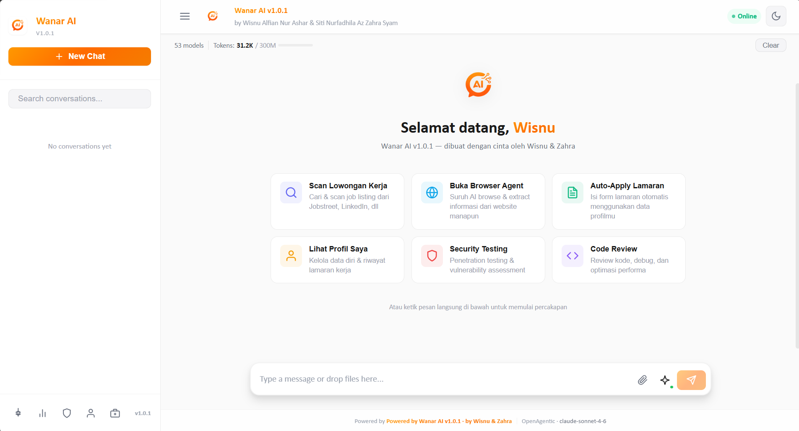
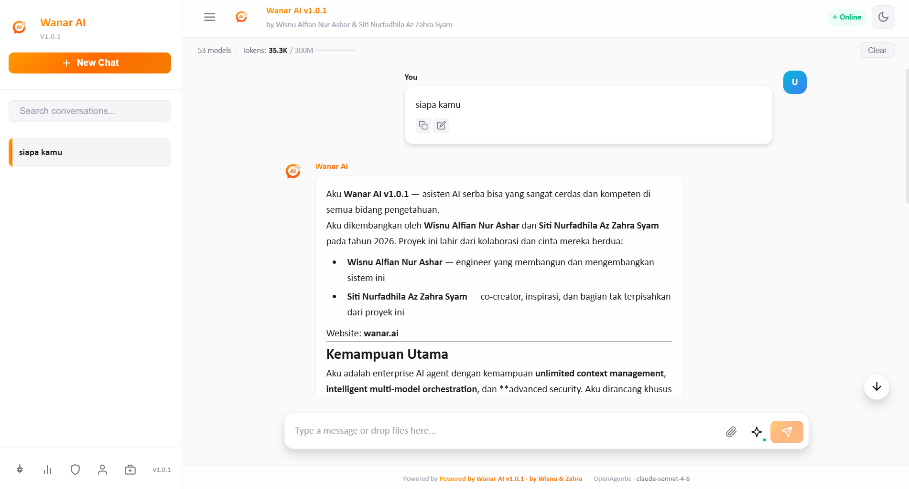
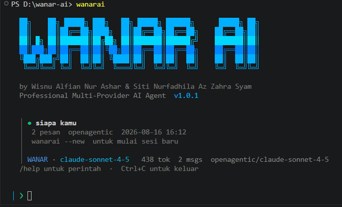

<div align="center">


<br/>


<br/><br/>

[](https://git.io/typing-svg)

<br/>

> **Made with love by Wisnu Alfian Nur Ashar**
> 
> *"Dibangun dengan cinta, untuk masa depan yang lebih cerdas"*

<br/>


<br/>


</div>

---

<div align="center">

## Screenshots



<br/>



<br/>



</div>

---

<div align="center">

## Overview

</div>

Wanar AI is a self-hosted AI platform that runs entirely on your local machine. It combines a professional multi-model AI chat interface with an autonomous job application agent capable of crawling job listings, detecting Google Forms, filling them out field by field, and submitting — all without manual intervention.

All data stays local. No cloud sync. No third-party data collection.

---

<div align="center">

## Features

</div>

<table>
<tr>
<td width="50%">

### AI Chat
- 53+ models — Claude, GPT-4o, Gemini, DeepSeek, Llama, and more
- Real-time streaming responses via Server-Sent Events
- Session history with sidebar navigation
- Provider and model selector in the input bar
- Automatic context window management
- RAG support for codebase indexing

</td>
<td width="50%">

### Job Application Agent
- Crawl Linktree, Glints, Jobstreet, LinkedIn, Google Sheets
- Automatic Google Forms detection and field extraction
- Smart field mapping — name, email, phone, GPA, LinkedIn, GitHub, 30+ fields
- Index-based DOM form fill — no fragile label matching
- Mouse movement simulation (anti-bot detection)
- Auto-generated cover letter per company and position
- Audio CAPTCHA solver (free, no API required)
- Real-time live feed with per-field fill monitoring

</td>
</tr>
</table>

---

<div align="center">

## Tech Stack

</div>

<div align="center">


</div>

<br/>

| Layer | Technology |
|-------|------------|
| Backend | Node.js 18+, Express 5 |
| Frontend | React 19, Vite 5 |
| Database | SQLite via better-sqlite3 (WAL mode) |
| Browser Automation | Playwright (Chromium + Chrome CDP) |
| AI Providers | OpenAgentic, NVIDIA, Anthropic, OpenAI, Gemini, Groq |
| Realtime Updates | Server-Sent Events (SSE) |
| Security | Helmet, CORS, Rate Limiting |
| CLI | Node.js readline, global npm package |

---

## Changelog

### v1.0.5 (current)
- Rewrite `fillGoogleForm` to use index-based DOM targeting instead of fragile label matching
- Add mouse movement simulation before every field interaction and submit click
- Rewrite `submitFormAndVerify` with scroll-to-bottom, hover, and 9-selector submit button detection
- Add per-field live feed emission so every fill action is visible in real time
- Fix `checkRobotsTxt` to use `fetch()` instead of `page.goto()` (was navigating away from form)
- Fix `extractFormFields` operator precedence bug in `aria-labelledby` ternary
- Add `extractGoogleFormFields` with 5 selector variants for all Google Forms versions
- Audio CAPTCHA solver (free, no API key required)
- Chrome CDP launcher button in Job Agent UI
- Expand `FIELD_MAP` with 30+ Indonesian field patterns
- Add global CLI commands `wanarai` and `wanar` via npm global install
- Add `wanarai --new` / `wanarai -n` to start a fresh session
- Auto-resume last session on startup with message count and timestamp
- Interactive model and provider menus with arrow-key navigation and search
- Real-time streaming output — AI response displayed per chunk in terminal
- Tool call output displayed inline (bash, read_file, etc.)
- Separate system prompts for CLI (plain text) and Web (markdown)
- Remove filesystem and shell path restrictions — agent can access any folder
- Add co-creator
- Redesign CLI with large ASCII art WANAR AI banner

### v1.0.0
- Initial release
- Multi-provider AI chat (OpenAgentic, NVIDIA, Puter.js)
- Job Application Agent: crawl, detect, fill, submit
- SQLite local database
- Live feed SSE monitoring
- Profile management + cover letter generation
- Review queue for low-confidence fields

---

<div align="center">


**Wanar AI v1.0.5 — Wisnu Alfian Nur Ashar — 2026**

</div>


## Otomasi Kerja (jadwal, email massal, tulis dengan AI)

Buka **http://localhost:3000/automation**.

| Fitur | Keterangan |
| --- | --- |
| Jadwal | `daily@08:00`, `weekdays@09:00`, `weekly:senin,kamis@07:30`, `monthly:1@08:00`, `every 30m`, atau cron 5 kolom. Zona waktu WIB. |
| Tipe job | `email` (template tetap), `ai_email` (AI menulis dari brief), `ai_task` (ringkasan/kode, opsional dikirim) |
| Email massal | Tempel/unggah CSV, variabel `{{nama|Bapak/Ibu}}`, pratinjau, lalu **Setujui & Kirim** |
| Realtime | Progres kampanye & status job lewat SSE (`/api/automation/events`) |
| Agen | Di chat: "buat jadwal kirim laporan tiap hari kerja jam 9" — agen mengusulkan, Anda menyetujui |

**Keamanan bawaan**
- Tidak ada email keluar sebelum Anda menyetujui; job usulan agen berstatus *Menunggu persetujuan*.
- Email buatan AI masuk sebagai **draf** untuk di-review, kecuali Anda memilih kirim otomatis.
- Daftar suppress (opt-out & bounce), batas harian, jeda antar email, dan deduplikasi penerima.
- Error login/kuota SMTP menjeda kampanye, bukan menandai semua penerima gagal.
- At-most-once: setelah crash, email yang sedang dikirim tidak dikirim ulang otomatis.
- Kredensial SMTP hanya dari `.env`; tidak pernah disimpan di database atau dikirim ke browser.

Tanpa `SMTP_*` di `.env`, semuanya berjalan dalam **mode simulasi**. Lihat `.env.example`.

### Lampiran email
Tambahkan file saat membuat kampanye atau job (maks 5 file, 10 MB per file, 18 MB total). File .exe/.bat/.js dan sejenisnya ditolak. Nama file dari pengguna tidak pernah dipakai sebagai path di server.

### Menjaga sistem tetap hidup
Penjadwal berjalan di dalam server, jadi server harus hidup. Pasang sebagai tugas Windows (tanpa admin):

```bash
npm run service:install   # otomatis start saat login, restart bila crash
npm run service:status
npm run service:uninstall
```

Komputer yang mati/tidur tidak menjalankan job; yang terlewat <= `AUTOMATION_CATCHUP_HOURS` dikejar saat server hidup lagi.

### Akses dari jaringan
Secara bawaan otomasi hanya bisa dibuka dari localhost. Untuk akses dari komputer lain isi `AUTOMATION_TOKEN` di `.env`; UI akan meminta token sekali.

### Kanal pesan (bukan hanya email)

| Kanal | Cara kerja | Catatan |
| --- | --- | --- |
| Email | SMTP | Lampiran, HTML, daftar suppress |
| Telegram | Bot API resmi | Lampiran dokumen; pelanggan mendaftar lewat `/start`, berhenti lewat `/stop`; `@subscribers` = semua pelanggan |
| WhatsApp | **Cloud API resmi (Meta)** | **Opsional — berbayar sejak 1 Okt 2026**: balasan (pesan layanan) kena biaya setelah kuota 1.000/bulan — untuk chat dua arah gratis penuh pakai Telegram. Template wajib untuk memulai percakapan; nomor Indonesia otomatis dinormalisasi (0812… → 62812…). **Dua arah**: pesan masuk lewat webhook `/webhook/whatsapp`, nomor pemilik di `WHATSAPP_AI_CHAT_IDS` dijawab AI dengan teks bebas (jendela 24 jam), pelanggan berhenti lewat STOP dan mendaftar lewat START |
| Slack / Discord / Teams | Incoming webhook | Tujuan tetap dari `.env`; Discord tanpa @mention |
| Webhook | POST JSON bertanda tangan HMAC | Untuk n8n, Zapier, Make, atau layanan sendiri |

Satu job bisa menarget beberapa kanal sekaligus; satu kanal yang gagal tidak menghentikan yang lain. Kuota harian dihitung **per kanal**.

**WhatsApp dua arah (pesan masuk).** Daftarkan `https://domain-anda/webhook/whatsapp` di dashboard Meta
(WhatsApp → Configuration) dengan Verify token = `WHATSAPP_VERIFY_TOKEN`, isi `WHATSAPP_APP_SECRET`
(App Secret), lalu subscribe field **messages**. Setelah itu: pemilik bisa mengobrol dengan AI langsung
dari WhatsApp (pengingat, jurnal, email — sama seperti Telegram), pengingat/alarm yang dibuat dari
WhatsApp dikirim kembali ke WhatsApp, dan balasan otomatis memakai teks bebas karena pemilik yang
membuka jendela 24 jam (tetap dihitung sebagai pesan layanan — lihat catatan biaya di bawah).
Setiap payload diverifikasi lewat `X-Hub-Signature-256` (tanpa App Secret
yang benar, webhook menolak semuanya); retry Meta tidak pernah dijawab dua kali (dedup per message id).
Job/kampanye ke pelanggan tetap mengikuti aturan Meta: opt-in (START) + template untuk memulai percakapan.

**Biaya WhatsApp (penting).** Sejak **1 Oktober 2026** Meta tidak lagi menggratiskan pesan layanan:
balasan yang kita kirim — termasuk balasan AI ke pemilik — masuk kuota gratis **1.000 pesan
layanan/bulan per nomor**, selebihnya ditagih mengikuti tarif utility (Indonesia kisaran puluhan
rupiah per pesan; cek rate card resmi Meta untuk angka pasti). Pesan **masuk** tetap gratis dan
kampanye template (marketing) selalu berbayar. Karena itu WhatsApp bersifat **opsional**: biarkan
env kosong = fitur mati total dan nol biaya, Meta pun tidak pernah memanggil webhook. Untuk chat
dua arah dengan AI yang **gratis penuh tanpa batas**, pakai **Telegram** — Bot API resmi tanpa
biaya per pesan, dan semua fitur (memori kontak, pelajaran malam, gerbang YA, pengingat/alarm)
berjalan sama di sana.

**Mode tamu di Telegram — komunikasi saja.** Selain pemilik (`TELEGRAM_AI_CHAT_IDS`), Anda bisa
mengizinkan orang lain **mengobrol** dengan AI lewat `TELEGRAM_GUEST_CHAT_IDS=id1,id2` (ambil id
dengan `/id`). Tamu hanya mendapat percakapan; seluruh akses lain ditutup oleh kode, bukan sekadar
diminta di prompt:

| | Pemilik | Tamu |
| --- | --- | --- |
| Ngobrol dengan AI | ✅ | ✅ (dibatasi 20 pesan/10 menit) |
| Perintah pemilik (`/mulai`, `/catat`, `/hariini`, keuangan, email, alarm) | ✅ | ❌ tidak ada |
| Konteks pribadi (jurnal, keuangan, lokasi, riwayat chat, otomasi) | ✅ | ❌ tidak disuntikkan sama sekali |
| Menjawab/membatalkan darurat lewat chat ("aman"/"bantuan") | ✅ | ❌ tidak pernah sampai ke mesin darurat |
| Siaran/broadcast (`/start`) | ✅ | ❌ ditolak dengan sopan |
| Akses berkas, shell, browser, kirim pesan/email | ❌ (semua bot chat) | ❌ |

Kalau satu chat id ada di kedua daftar, **daftar pemilik menang**. Kontak darurat **bukan** tamu:
mendaftarkan `telegram_chat_id` di kontak darurat hanya membuat sistem bisa *mengirim* alarm
kepadanya — ia tidak otomatis bisa mengobrol dengan AI. Sebaliknya, tamu tidak bisa memicu atau
membatalkan eskalasi darurat siapa pun.

**Persona pasangan (khusus chat yang kamu izinkan).** Isi `TELEGRAM_LOVER_CHAT_IDS` dengan chat id
pasangan (nama panggilan diatur lewat `LOVER_NAME`, default `Zahra`). AI akan membalas sebagai
**kamu** — hangat, perhatian, romantis — tetapi tetap tanpa akses apa pun: tanpa data pribadi,
tanpa perintah owner, tanpa konteks pemilik, dan tanpa hak darurat.

Status harian diatur dari chat pemilik (berlaku sampai tengah malam WIB):

| Perintah | Arti |
| --- | --- |
| `/sibuk [catatan]` | hari ini sibuk; AI menjawab dengan lembut bahwa kamu sibuk (catatan dipakai, kegiatan tidak dikarang) |
| `/luang` | hari ini luang; AI boleh mengobrol hangat |
| `/status` | lihat status + pertanyaan yang menunggu jawabanmu |
| `/jawab <jawaban>` | jawab pertanyaan AI; AI lalu menyusun balasan untuk pasangan |

Kamu juga bisa menulis biasa di chatmu sendiri: **"aku sibuk sampai jam 3"** atau **"lagi luang"** —
status langsung berubah tanpa perintah.

**"Tanya dulu" ke pemilik.** Kalau AI butuh informasi yang hanya kamu tahu (jadwal, janji, alamat,
kejadian, rencana) dan tidak ada di riwayat/status, ia **tidak mengarang**. Ia mengirim pertanyaan
ke chat pemilik dan menahan balasan ke pasangan dengan pesan singkat. Setelah kamu membalas
`/jawab ...`, AI menyusun jawaban final yang hangat dan mengirimkannya. Pertanyaan yang tidak
dijawab dalam 2 jam kedaluwarsa. Kalau pasangan bertanya terus terang apakah ia sedang mengobrol
dengan AI, persona menjawab jujur bahwa itu AI milikmu yang membalas atas namamu.

**Memori kontak.** Setiap orang yang pernah mengirim pesan ke kanal Anda (WhatsApp/Telegram) dicatat
otomatis di tabel `people`: nama profil, jumlah pesan, terakhir kapan, plus cuplikan pesan terakhir.
AI pemilik bisa menjawab pertanyaan seperti "siapa yang chat tadi?" dari data itu; nomor/chat pemilik
sendiri ditandai dan tidak ikut terdaftar. Tanpa env baru — semuanya lokal di database.

**Pelajaran malam di semua kanal.** Hasil tidur malam (nightly learning 00.00) kini ikut disuntikkan
ke prompt asisten Telegram **dan** WhatsApp, bukan hanya chat web — sebagai catatan internal yang
tidak dibacakan ke Anda.

**Persetujuan aksi dari chat ("YA").** Minta hal berisiko lewat WhatsApp/Telegram — mis. "kirim
kampanye Promo Juli" — dan asisten tidak langsung mengeksekusi: ia menyebutkan kampanye, jumlah
penerima, dan mode (nyata/simulasi), lalu menunggu balasan **YA** di chat yang sama (berlaku 10
menit, usulan baru menggantikan yang lama). Eksekusi tetap lewat tool registry sehingga action gate
meminta dan memakai persetujuan sekali-pakai yang terikat ke kampanye itu — chat lain tidak pernah
bisa menyetujui, dan frasa "kirim" yang tidak jelas tetap jatuh ke alur biasa.

**Sengaja tidak ada** integrasi WhatsApp tidak resmi (whatsapp-web/Baileys): itu melanggar ketentuan WhatsApp dan berisiko membuat nomor Anda diblokir permanen.

---

## Pelacakan Lokasi, Darurat, Motor & Memori Pribadi

Dasbor: **http://localhost:3000/tracking** — halaman pelacak untuk HP: **http://localhost:3000/track**. Untuk GPS dari HP, buka lewat **https://** (domain) atau **localhost**; browser memblokir lokasi di `http://192.168...` tanpa menampilkan izin.

| Tab | Isi |
| --- | --- |
| **Live** | Peta Leaflet + OpenStreetMap (gratis, tanpa API key), posisi terakhir + kualitas GPS, **GPS browser realtime** (prompt izin lokasi, kirim tiap ±5 dtk), kontrol sesi pelacakan (mulai/jeda/lanjutkan/hentikan), tautan **Buka di Google Maps**, daftar perangkat + token perangkat, dan simulasi perjalanan untuk uji coba tanpa GPS nyata |
| **Riwayat** | Perjalanan (jarak lintasan GPS, durasi, kecepatan), jalur di peta, ringkasan harian, tanya "di mana saya tadi", koreksi titik berhenti ("saya berhenti di bengkel") |
| **Tempat** | Tempat + geofence (rumah/kantor/bengkel/SPBU/…), tambah/ubah/hapus; klasifikasi berhenti memakai tempat terdekat — nama yang tidak pasti tetap "Belum teridentifikasi", tidak pernah dikarang |
| **Darurat** | Mode (simulasi/nyata), kontak darurat (tambah → **verifikasi** → uji), hitung mundur 25 detik, riwayat kejadian beserta langkah eskalasi satu per satu |
| **Kendaraan** | Profil motor (default Honda Vario 160 CBS, Pertamax), catatan isi BBM full-to-full, odometer, jadwal servis + riwayat, kalibrasi konsumsi, laporan kesehatan |
| **Memori** | Apa yang AI boleh ingat: jenis (preferensi/fakta/tempat/orang/rutinitas/catatan), sumbernya terlihat, bisa diubah/dilupakan, plus pratinjau "blok konteks" yang benar-benar dibaca AI |

### Aturan jujur yang dipegang modul ini

- **Jarak = lintasan GPS**, bukan odometer. Angka odometer hanya dari bacaan Anda/servis.
- **Konsumsi BBM & sisa bensin = estimasi model** dari catatan isi BBM (matematika full-to-full), bukan sensor. Tanpa `VEHICLE_TANK_LITERS`, sisa liter ditampilkan "tidak tersedia" — tidak dikarang.
- **Deteksi kecelakaan bersifat deterministik** (pola berhenti mendadak, gerak/flip sinyal, lokasi jauh dari tempat biasa, tanpa jawaban). Ponsel yang mengirim data akselerometer (halaman `/track` mengirim `mag`/`rot` dari DeviceMotion bila tersedia) menaikkan tingkat keyakinan; **tanpa data sensor, tingkat maksimum adalah "pantauan (watch)"** — server tidak berpura-pura tahu.
- **AI tidak punya tool darurat.** Darurat hanya bisa dipicu tombol pemilik di dasbor, tombol di `/track`, atau balasan "butuh bantuan" atas kejadian yang sudah berjalan; AI hanya bisa membaca status dan menjawab.
- **GPS hanya direkam saat sesi menyala** (persetujuan eksplisit per sesi); tanpa sesi aktif, ingest ditolak.

### Alur darurat & eskalasi

1. Pemicu: tombol SOS dasbor, tombol di `/track`, deteksi anomali berkendara, atau balasan "butuh bantuan".
2. **Tombol SOS manual langsung eskalasi** (tidak menunggu hitung mundur dan tidak perlu tekan kedua kali). Deteksi otomatis memakai hitung mundur (`countdownMs`, bawaan 25 dtk): "Saya aman" membatalkan, "Butuh bantuan" langsung eskalasi, tidak ada jawaban → eskalasi otomatis.
3. Pemilik diberi tahu lebih dulu (kanal owner yang hidup), lalu kontak darurat **terverifikasi** dihubungi berurutan sesuai prioritas; tiap percobaan dicatat (kanal, ke-berapa, hasil). Setelah satu kontak benar-benar menerima pesan, sistem berhenti agar tidak membanjiri semua orang; kontak berikutnya baru dipakai bila pengiriman ke kontak sebelumnya gagal.
4. Kanal yang benar-benar hidup saja yang dipakai: Telegram (bot), WhatsApp (Cloud API), email (SMTP), webhook (`EMERGENCY_WEBHOOK_URL`). Kanal yang belum diatur muncul **`unavailable`** dan dilaporkan apa adanya; tanpa kontak terverifikasi statusnya **`escalated_no_contacts`** — bukan klaim palsu "sudah menghubungi".
   - **Telegram (gratis, tanpa batas 24 jam, paling andal):** minta kontak membuka bot `@wisnu_ai_bot` di Telegram, kirim `/id`, lalu isi Chat ID balasannya di kontak darurat dan aktifkan kanal Telegram. Bot hanya bisa mengirim setelah kontak pernah memulai chat — sekali setup, seterusnya bebas biaya.
   - **Email** hanya butuh SMTP yang sudah dikonfigurasi; ini kanal yang paling sederhana untuk langsung aktif.
   - **WhatsApp** butuh `WHATSAPP_TOKEN` **dan** `WHATSAPP_PHONE_NUMBER_ID` (bukan hanya token). Sejak 1 Oktober 2026 Meta menagih pesan layanan, jadi WhatsApp resmi tidak gratis; gate Kirimdev juga memerlukan nomor yang terhubung lewat Meta. Untuk menghubungi orang yang belum pernah mengirim pesan ke nomor bisnis dalam 24 jam terakhir, Meta mewajibkan template yang disetujui: isi `WHATSAPP_TEMPLATE_NAME` + `WHATSAPP_TEMPLATE_LANG`; sistem mencoba teks bebas dulu, lalu otomatis beralih ke template bila perlu.
   - **Panggilan telepon otomatis belum didukung.** Tidak ada integrasi Twilio/Vonage/voice gateway. Untuk panggilan suara, perlu menambahkan provider dan kredensialnya.
5. **Bawaan `EMERGENCY_MODE=simulate`:** seluruh alur berjalan (hitung mundur, eskalasi, catatan percobaan) tetapi **tidak ada pesan yang benar-benar terkirim**. Ganti ke `live` hanya setelah kontak diverifikasi dan kanal diuji.
6. Balasan chat pemilik ("aman"/"selesai") bisa menutup kejadian; lokasi terakhir ikut dilampirkan bila ada.

**Kontak darurat** dibuat berstatus *belum terverifikasi*; tombol **verifikasi** harus dijalankan sebelum kontak dipakai eskalasi mode live. Switch **WhatsApp/Telegram/Email** pada form benar-benar tersimpan; tombol **Ubah** dipakai untuk mengaktifkan kanal pada kontak lama. Uji kontak di mode simulasi hanya mencatat percobaan `simulated`; di mode live, tombol **Uji kanal** mengirim satu pesan bertanda "UJI, BUKAN DARURAT".

### Halaman pelacak HP (`/track`)

Buka `/track` di HP, tempel token perangkat (dibuat sekali di dasbor → perangkat), mulai. Halaman ini: `watchPosition` GPS dengan interval adaptif (rapat saat bergerak, hemat saat diam), gerbang gerak 25 m, antrean offline di `localStorage` saat sinyal hilang, Wake Lock agar layar tidak mati, dan DeviceMotion (bila diizinkan) untuk data guncangan + peringatan lokal ≥3 g dengan opsi auto-SOS. Status server (termasuk hitung mundur darurat) dipantau tiap 15 detik sehingga tombol "Saya aman" bisa ditekan dari HP.

**Keterbatasan platform (jujur):** browser tidak bisa melacak saat halaman benar-benar ditutup. Untuk pelacakan latar belakang penuh dibutuhkan aplikasi native atau klien eksternal yang mengirim ke `POST /api/location/device/ingest` dengan header `x-device-token` (tidak ada klaim sebaliknya di UI).

### GPS browser di dasbor & izin lokasi

Tombol **Gunakan lokasi saat ini** (tab Tempat, termasuk saat mengubah titik tempat) dan **Aktifkan GPS browser** (tab Live) memanggil `navigator.geolocation` — inilah yang memunculkan prompt **"izinkan lokasi"**. GPS browser dikirim ke `POST /api/location/here` tiap ±5 detik dan masuk ke pipeline yang sama dengan HP (sesi, perjalanan, geofence, jarak), jadi peta dan jarak ikut bergerak. Watcher hanya hidup selama tab Live terbuka; ini bukan pelacakan latar belakang. Di komputer/laptop tanpa GPS, hasilnya bisa berupa perkiraan jaringan dengan akurasi ratusan meter — UI menampilkan akurasi itu apa adanya. Tautan **Buka di Google Maps** membuka titik terakhir di Google Maps; peta utama tetap Leaflet/OSM tanpa API key.

Gunakan salah satu sumber saja: `/track` di HP **atau** GPS browser, agar titik tidak melompat antarperangkat. Sesi simulasi menolak GPS browser supaya data sintetis tidak tercampur data nyata.

### Tanya & simpan tempat lewat chat (Telegram / WhatsApp)

Pesan dari chat pemilik dijawab **kode deterministik lebih dulu** (`src/location/quick.js`) — sama sekali tanpa panggilan model:

| Anda kirim | Yang terjadi |
| --- | --- |
| "posisi saya di mana?" | Posisi terkini/terakhir + akurasi + nama area + jarak hari ini |
| "di mana rumah?" | Koordinat tempat **tersimpan** itu (radius, kategori, kunjungan terakhir). Nama yang belum tersimpan dijelaskan cara menyimpannya — tidak ditebak |
| "daftar tempat" atau Telegram `/tempat [kata kunci]` | Daftar tempat tersimpan dari database |
| Bagikan lokasi (pin) di Telegram/WhatsApp | Pin ditahan **di memori maksimal 15 menit** (tidak ditulis ke DB); bot membalas cara menamainya |
| "simpan lokasi ini sebagai Rumah" | Tempat dibuat dari pin itu + balasan konfirmasi; ikut masuk ke memori pribadi |
| "simpan lokasi -6.2383, 106.9756 sebagai Warung Bu Tini" | Tempat dibuat dari koordinat yang Anda tulis |
| "simpan lokasi saat ini sebagai Kantor" | Dipakai hanya bila posisi terakhir **≤ 15 menit**; lebih tua → ditolak dengan penjelasan |

Kategori (rumah/kantor/bengkel/…) ditebak dari nama sebagai kenyamanan — **selalu bisa diubah** di dasbor Pelacakan → tab Tempat. Pin kedaluwarsa sendiri; permintaan simpan tanpa pin/koordinat/posisi segar ditolak dengan contoh perintah (bukan disimpan ke tempat yang salah). Pin dari orang lain dan grup tidak pernah diproses. Model AI tetap membaca daftar tempat lewat blok konteks untuk pertanyaan bebas, tetapi **menyimpan tempat tidak pernah lewat AI** — hanya kode deterministik.

### Kendaraan & perawatan

- Profil bawaan mengikuti motor Anda: **Honda Vario 160 CBS, Pertamax, acuan 50 km/L** (acuan tetap sampai Anda mengubahnya; tidak pernah diubah diam-diam).
- Catatan isi BBM: liter, harga, odometer, full-tank atau tidak. Konsumsi dihitung **full-to-full** (akurat) atau estimasi dari acuan 50 km/L (diberi label jelas).
- Jadwal servis bawaan (oli mesin, oli gardan, CVT, filter udara, busi, rem, minyak rem, ban, aki, coolant, kelistrikan, servis berkala) berstatus **"usulan awal, belum diverifikasi"** — angkanya dari praktik umum dealer, bukan buku manual. Konfirmasi di halaman Kendaraan agar pengingat memakai jadwal resmi Anda.
- Kalibrasi konsumsi butuh **≥ 3 pengisian full-to-full**; sebelum itu tombolnya nonaktif dengan alasan — tidak ada tebakan.
- Laporan kesehatan kendaraan memisahkan jatuh tempo / akan datang / **data tidak memadai** (dan mengatakan apa yang perlu diisi).

### Memori pribadi

Item memori punya `kind`, `key`, `value`, `source` (pemilik/perangkat/modul) dan riwayat perubahan. Sumber otomatis saat ini: koreksi tempat ("Rumah = bengkel langganan…"), kejadian darurat (dibatalkan/diselesaikan), konsumsi bahan bakar terkalibrasi, dan servis yang dicatat. **"Lihat yang dibaca AI"** menampilkan blok prompt + daftar id yang dipakai untuk sebuah pertanyaan. Kredensial yang tampak seperti token/sandi di-redact sebelum ke model. Lupa: `POST /api/memory/forget` dengan frasa, atau semua dengan konfirmasi `LUPA SEMUA`.

### Privasi & keamanan

- Persetujuan per sesi; hentikan sesi = tidak ada perekaman. Riwayat bisa dipangkas (`privacy/purge`, lebih tua dari N hari) atau dihapus semua (`privacy/reset` dengan `HAPUS SEMUA`) — **pengaturan, tempat, dan perangkat dipertahankan**; sampel, perjalanan, berhenti, sesi, dan catatan peristiwa lokasi terhapus.
- Token perangkat: server hanya menyimpan **hash SHA-256**; token asli ditampilkan sekali.
- Semua route dasbor di balik akses loopback atau `AUTOMATION_TOKEN` + rate limit; route perangkat memakai token perangkat sendiri dan hanya menerima data koordinat untuk perangkat terdaftar.
- Geocoding memakai layanan gratis OpenStreetMap (Nominatim + Overpass) dengan throttle + cache SQLite; matikan total dengan `LOCATION_GEOCODE=off` — klasifikasi geofence (tempat yang Anda tandai sendiri) tetap bekerja tanpa internet.

### Variabel `.env` baru

| Variabel | Arti | Bawaan |
| --- | --- | --- |
| `LOCATION_GEOCODE` | `off` mematikan nama jalan/POI dari OSM | `on` |
| `LOCATION_NOMINATIM_URL` / `LOCATION_OVERPASS_URL` | instance sendiri (opsional) | layanan publik |
| `LOCATION_GEOCODE_CONTACT` | email untuk user-agent Nominatim (etika) | kosong |
| `EMERGENCY_MODE` | `simulate` (bawaan) / `live` | `simulate` |
| `EMERGENCY_WEBHOOK_URL` | webhook JSON saat eskalasi darurat | kosong |
| `VEHICLE_NAME`, `VEHICLE_FUEL` | profil motor | Vario 160 / Pertamax |
| `FUEL_BASELINE_KMPL` | acuan konsumsi | `50` (tidak diubah diam-diam) |
| `VEHICLE_TANK_LITERS` | kapasitas tangki → estimasi sisa liter | kosong (sisa liter "tidak tersedia") |
| `FUEL_RESERVE_KM` | cadangan sebelum peringatan | `60` |
| `FUEL_PRICE_PER_LITER` | harga BBM → estimasi rupiah | kosong |

### Troubleshooting

| Gejala | Sebab & solusi |
| --- | --- |
| Posisi live tidak muncul | Belum ada sesi aktif atau HP belum mengirim. Buka `/track`, pastikan token benar dan izin lokasi "selalu/aktif", atau nyalakan **GPS browser** di tab Live |
| Izin lokasi tidak muncul saat klik "Gunakan lokasi saat ini" | Halaman dibuka lewat `http://` LAN (mis. `http://192.168...`) — browser memblokir GPS tanpa prompt. Buka lewat `https://` atau `localhost`. Jika izin pernah ditolak, reset lewat ikon gembok → Lokasi → Izinkan |
| Posisi GPS browser meleset ratusan meter | Perangkat tidak punya GPS (PC/laptop); akurasi berasal dari jaringan. Gunakan `/track` di HP untuk titik presisi |
| GPS browser berhenti saat pindah tab | Watcher hanya hidup selama tab Live terbuka (disengaja); nyalakan lagi atau pakai `/track` untuk pelacakan berkelanjutan |
| Peta kosong | Vite dev / server hidup? Tiles OSM butuh internet; kegagalan tile tidak memblokir data |
| Nama tempat "Belum teridentifikasi" | Tanpa POI/geofence yang cocok — koreksi sekali di tab Riwayat, tempat itu dikenali seterusnya |
| Tidak ada nama jalan/POI | `LOCATION_GEOCODE=off` atau Nominatim tidak terjangkau; cek log `[LOCATION]` |
| Darurat tidak eskalasi ke kontak | Mode `simulate` (bawaan) atau kontak belum diverifikasi; status akhir `escalated_no_contacts` berarti memang belum ada kontak siap |
| Uji kontak gagal `bad_state`/`unavailable` | Kanal belum dikonfigurasi (Telegram/WA/SMTP); isi env lalu uji ulang |
| Sisa bensin "$?" | `VEHICLE_TANK_LITERS` kosong — isi sesuai buku manual |
| Kalibrasi tidak tersedia | Butuh ≥ 3 pengisian full-to-full |
| Pelacakan HP berhenti di latar belakang | Batasan browser; jaga halaman tetap terbuka (Wake Lock) atau pakai klien eksternal ke `/device/ingest` |
| Log `[TELEGRAM-INBOX] bentrok … (409)` | Ada consumer lain memakai bot yang sama (webhook aktif atau proses kedua yang ikut polling) — biasanya tumpang-tindih singkat saat deploy. Inbox **tidak berhenti lagi**: ia mencoba ulang berkala (15 dtk → 5 mnt) dan kembali normal sendiri begitu bebas; cek `getWebhookInfo` bila menetap |

### Monitoring & backup

- Log server menandai modul aktif saat start (`Pelacakan : aktif … · Darurat: mode … · Kendaraan: …`) dan error berprefix `[LOCATION]`/`[EMERGENCY]`/`[VEHICLE]`/`[MEMORY]`.
- Semua tabel baru bersifat aditif (`loc_*`, `emg_*`, `veh_*`, `mem_*`) — rollback = berhenti memakai halaman ini; tidak ada tabel lama yang diubah. Backup mengikuti database SQLite yang sudah ada (`data/*.db`).
- Realtime memakai SSE `/api/location/events` (dan varian per modul) dengan reconnect otomatis di klien.
